# Lab9Web - Praktikum 9: PHP Modular

Project praktikum Pemrograman Web tentang modularisasi program PHP: template (header/footer), function (helper), struktur direktori, routing dengan whitelist, dan refactoring aplikasi CRUD.

- Nama : Muhammad Zaki Ramadhan
- NIM  : 312510100
- Kelas: 1.25.2A

## Tujuan Project
1. Memahami modularisasi dan perbedaan `include`, `require`, `include_once`, `require_once`.
2. Membuat template halaman yang dipakai bersama.
3. Membuat function PHP dengan parameter dan nilai kembalian.
4. Menerapkan router sederhana dengan validasi halaman (whitelist) dan halaman 404.
5. Mengintegrasikan semuanya ke aplikasi CRUD database.

## Kebutuhan Perangkat
- PHP 8.0 atau lebih baru
- Apache + MySQL/MariaDB (XAMPP atau Laragon)
- Browser dan Visual Studio Code

## Cara Menjalankan
1. Salin folder `Lab9Web` ke docroot (`htdocs` untuk XAMPP, `www` untuk Laragon).
2. Nyalakan Apache dan MySQL.
3. Khusus `latihan4_crud`: impor `latihan4_crud/database.sql` melalui phpMyAdmin, lalu sesuaikan user/password di `latihan4_crud/config/database.php` bila perlu.
4. Buka di browser:

| Latihan | URL |
|---|---|
| Praktik include | `http://localhost/Lab9Web/latihan0_include/uji-include.php` dan `uji-require.php` |
| Latihan 1 (template) | `http://localhost/Lab9Web/latihan1_template/home.php` |
| Latihan 2 (function) | `http://localhost/Lab9Web/latihan2_function/halaman1.php` |
| Latihan 3 (router) | `http://localhost/Lab9Web/latihan3_router/index.php` |
| Latihan 4 (CRUD) | `http://localhost/Lab9Web/latihan4_crud/index.php` |

## Struktur Direktori
```
Lab9Web/
├── latihan0_include/      # uji include vs require
│   ├── pesan.php
│   ├── uji-include.php
│   └── uji-require.php
├── latihan1_template/     # header, footer, 3 halaman
├── latihan2_function/     # helpers/functions.php + 2 halaman
├── latihan3_router/       # router whitelist 5 rute + 404
│   ├── index.php
│   ├── helpers/ views/ modules/ assets/
└── latihan4_crud/         # CRUD modular
    ├── index.php          # router
    ├── database.sql
    ├── config/database.php
    ├── helpers/functions.php
    ├── views/             # header, footer, dashboard, 404
    ├── modules/user/      # list, add, edit, delete
    └── assets/css, js
```

## Daftar Rute
**Latihan 3**: `dashboard`, `about`, `kontak`, `produk/list`, `produk/add`

**Latihan 4**: `dashboard`, `login`, `logout`, `user/list`, `user/add`*, `user/edit`*, `user/delete`* (*wajib login)

Rute yang tidak ada di whitelist menghasilkan HTTP 404 dengan halaman `views/404.php`.

## Fitur Keamanan
- Router memakai whitelist, input `page` tidak pernah langsung dipakai sebagai path file.
- Semua output memakai `e()` (`htmlspecialchars`) untuk mencegah XSS.
- Query database memakai prepared statement PDO.
- Hapus/tambah/ubah data lewat POST dengan token CSRF; hapus tidak bisa lewat URL GET.
- Detail error koneksi database tidak ditampilkan ke pengguna.

## Tantangan Mandiri (latihan4_crud)
1. **Menu aktif**: `navClass()` memberi class `active` pada menu sesuai rute yang dibuka.
2. **Helper pesan sukses/gagal**: `setFlash()` menyimpan pesan di session, `tampilkanFlash()` menampilkannya sekali setelah operasi CRUD.
3. **Pembatasan akses (login)**: rute `user/add`, `user/edit`, `user/delete` ada di array `$protected` pada `index.php`. Pengguna belum login diarahkan ke halaman `login`. Login memakai `password_verify()`, `session_regenerate_id()`, dan logout via POST + CSRF.
   - Akun demo: username `admin`, password `admin123` (diatur di `config/app.php`).
4. **URL rewrite (.htaccess)**: file `latihan4_crud/.htaccess` mengubah `/user/list` menjadi `index.php?page=user/list`.
   - Syarat: modul `mod_rewrite` aktif dan `AllowOverride All` (default XAMPP sudah aktif).
   - Alamat contoh: `http://localhost/Lab9Web/latihan4_crud/user/list`
   - Helper `url()` dan tag `<base href>` membuat link dan CSS tetap benar.
   - Jika rewrite tidak jalan, ubah `CLEAN_URL` menjadi `false` di `config/app.php`.

## Langkah Praktikum

### 1. Persiapan lingkungan
Apache dan MySQL dinyalakan lewat XAMPP Control Panel. Folder proyek diletakkan di `C:\xampp\htdocs\Lab9Web`.

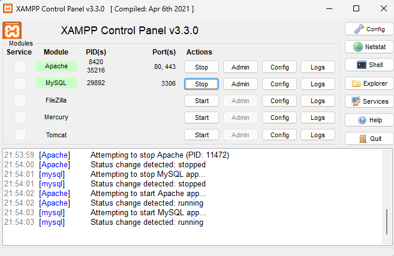

Database untuk Latihan 4 dibuat dengan mengimpor `latihan4_crud/database.sql` melalui phpMyAdmin.

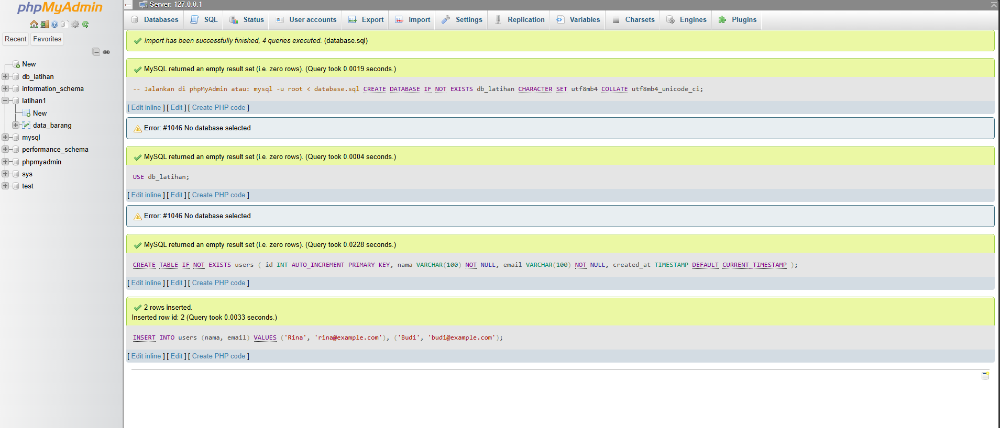

> Dua pesan "#1046 No database selected" pada log import hanya tampilan baris perintah; tabel `users` dan 2 data awal tetap berhasil dibuat.

### 2. Struktur direktori
Struktur dibuat sesuai modul: `config/`, `helpers/`, `views/`, `modules/`, `assets/`.

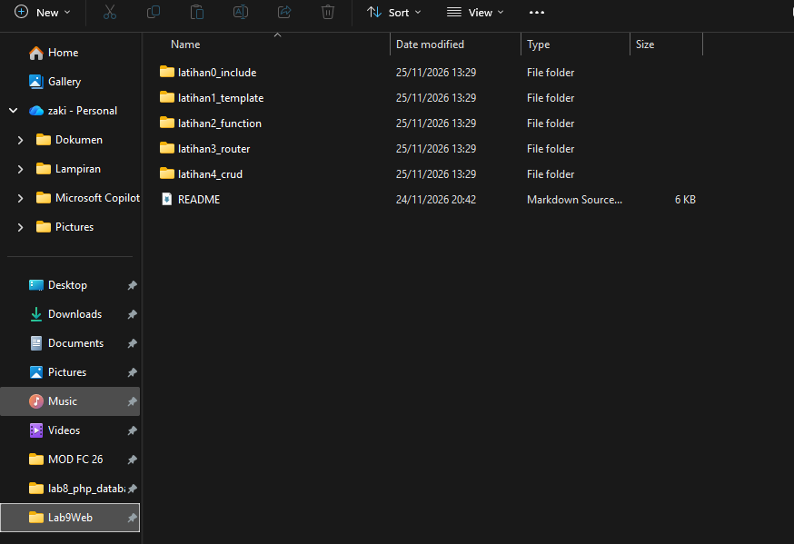

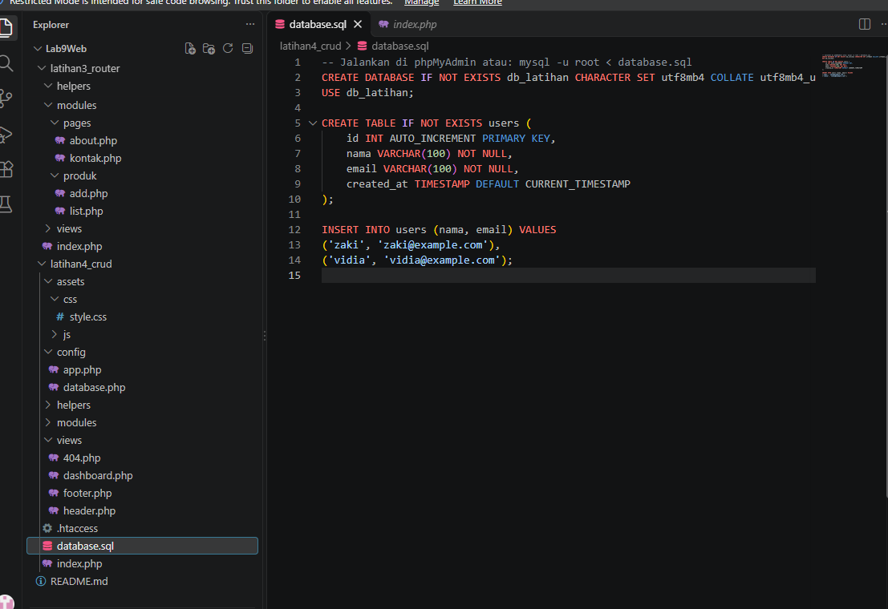

### 3. Praktik include dan require (`latihan0_include`)
`uji-include.php` dan `uji-require.php` memanggil `pesan.php`. Setelah nama `pesan.php` sengaja diubah, `include` hanya menampilkan peringatan dan program tetap berjalan, sedangkan `require` menghentikan program dengan error fatal.

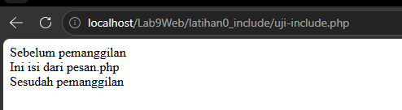

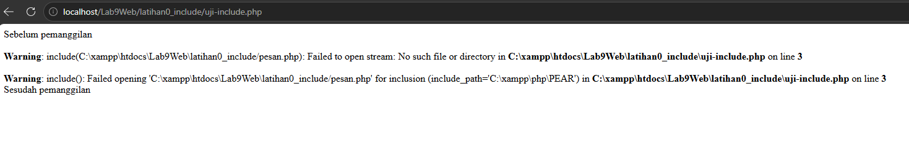

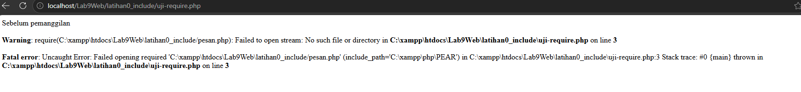

### 4. Latihan 1: Template (`latihan1_template`)
`header.php` dan `footer.php` dipakai bersama oleh tiga halaman memakai `require_once`, sehingga perubahan tampilan cukup dilakukan di satu tempat.

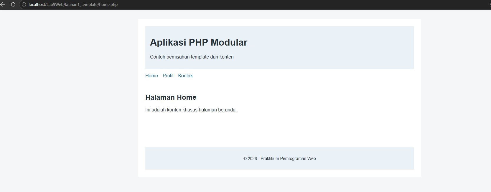

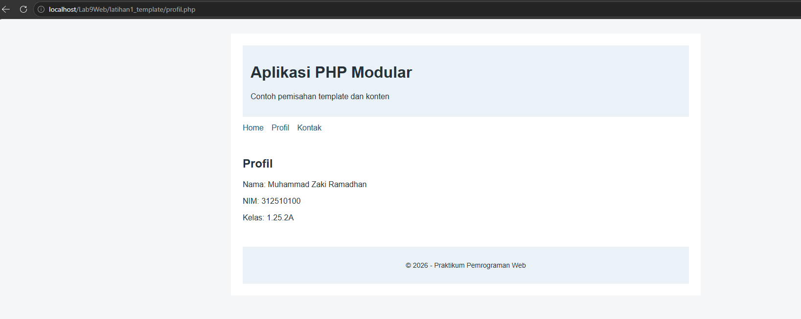

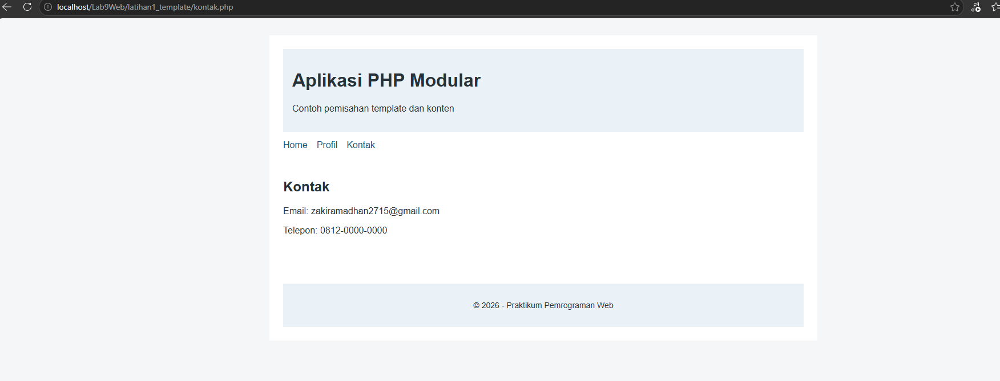

### 5. Latihan 2: Function (`latihan2_function`)
`helpers/functions.php` berisi `e()`, `formatRupiah()`, `hitungDiskon()`, `validasiEmail()`, `ringkasTeks()`, `konversiCelciusKeFahrenheit()`, `tentukanStatusNilai()`, dan `hitungTotal()`. Fungsi dipakai di dua halaman.

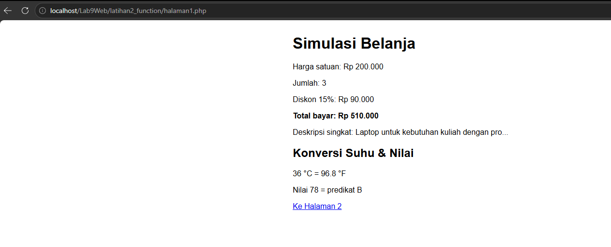

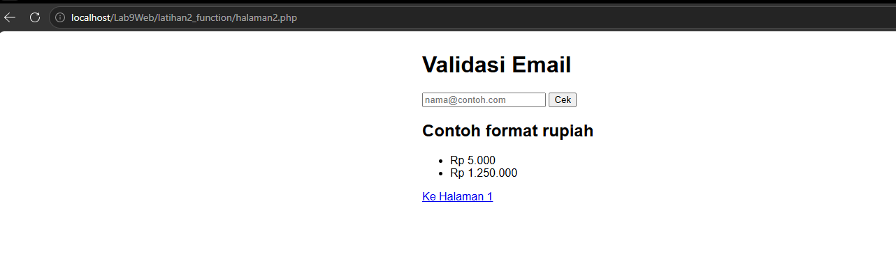

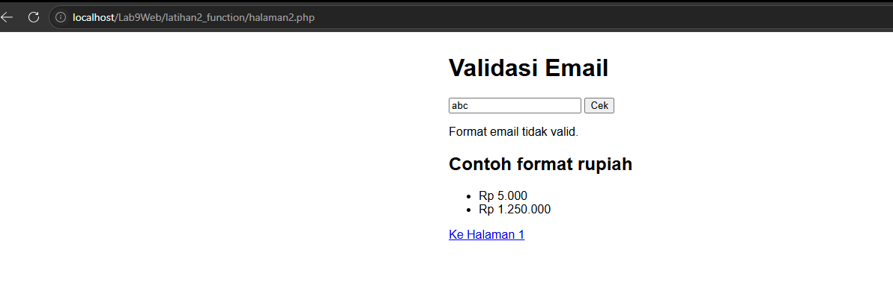

### 6. Latihan 3: Routing (`latihan3_router`)
`index.php` menjadi satu pintu masuk. Parameter `page` dicocokkan dengan array whitelist `$routes`; rute di luar daftar menampilkan halaman 404 dengan status HTTP 404.

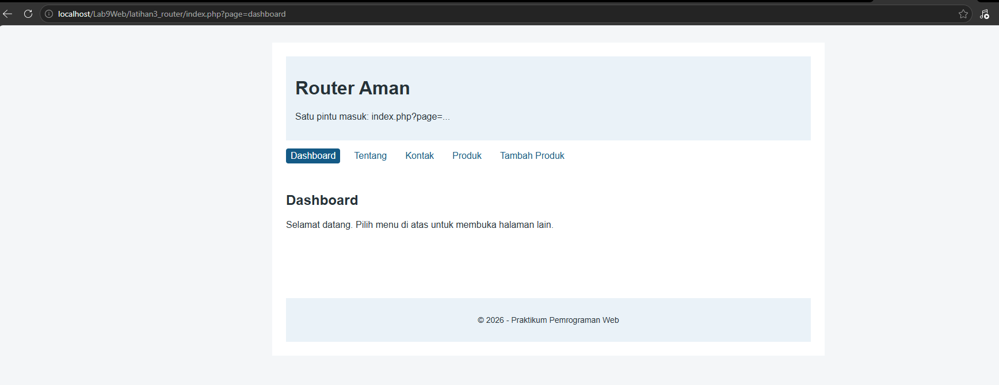

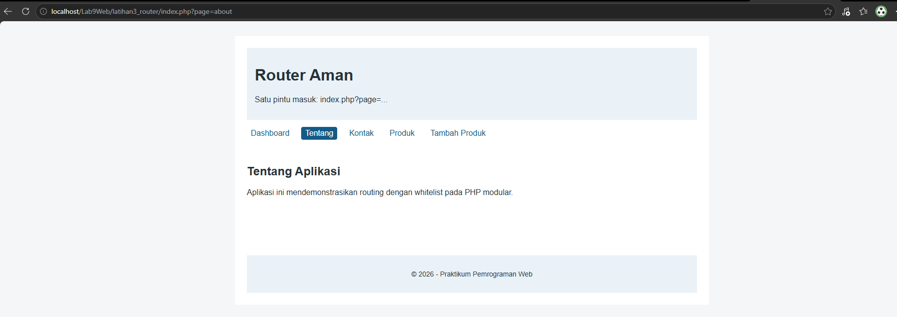

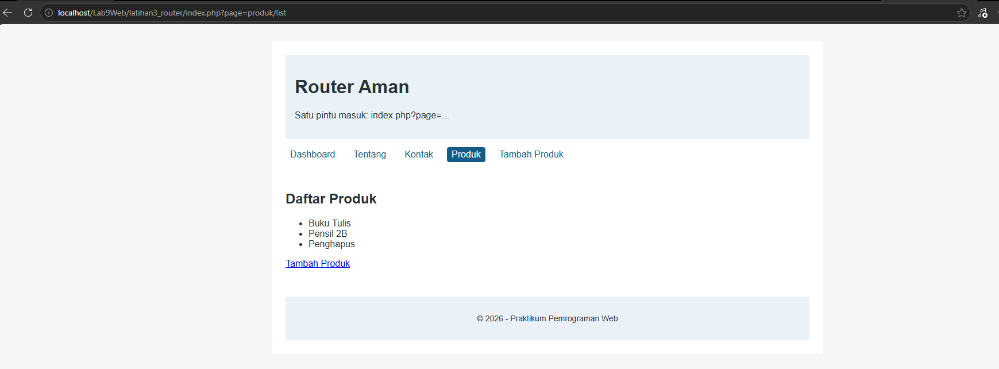

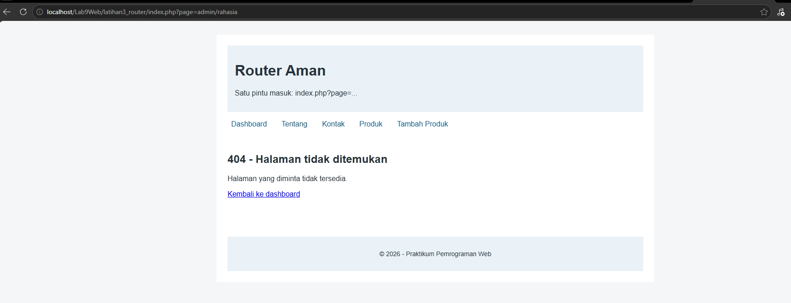

### 7. Latihan 4: Refactoring CRUD (`latihan4_crud`)
Aplikasi CRUD dipecah menjadi modul. Semua akses lewat `index.php`. Tambah, ubah, dan hapus hanya bisa dilakukan setelah login.

**a. Daftar pengguna sebelum login** (tanpa tombol Ubah/Hapus, URL bersih `/user/list`, menu aktif)

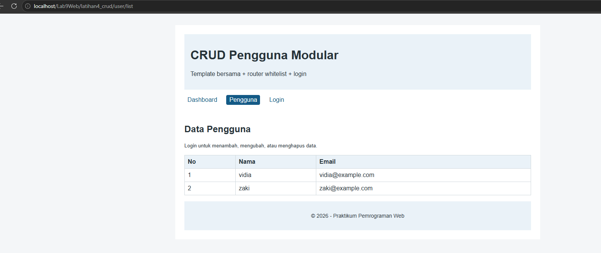

**b. Proteksi halaman**: membuka `/user/add` tanpa login dialihkan ke halaman Login

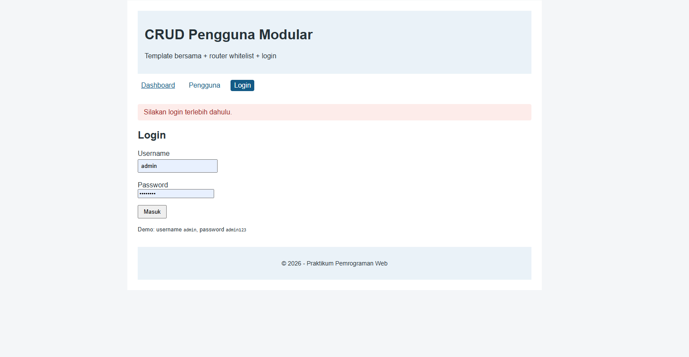

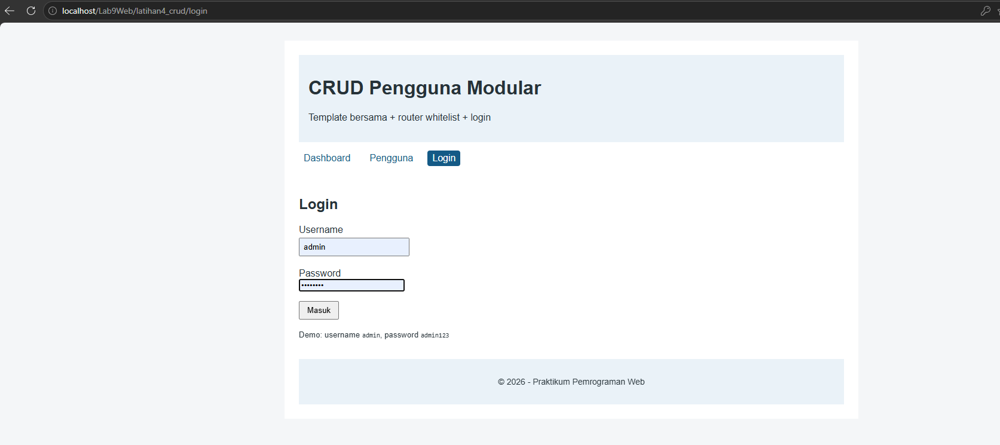

**c. Login berhasil** (muncul pesan sukses, tombol Logout, dan kolom Aksi)

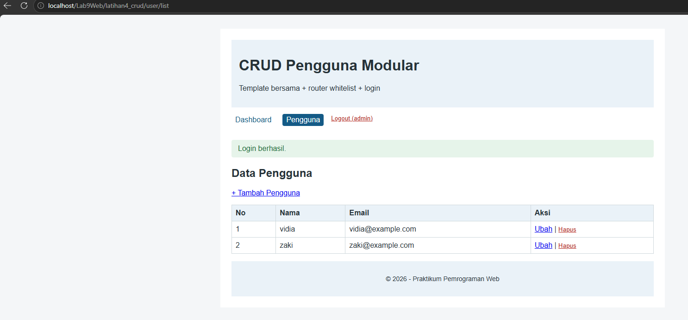

**d. Create**: tambah pengguna

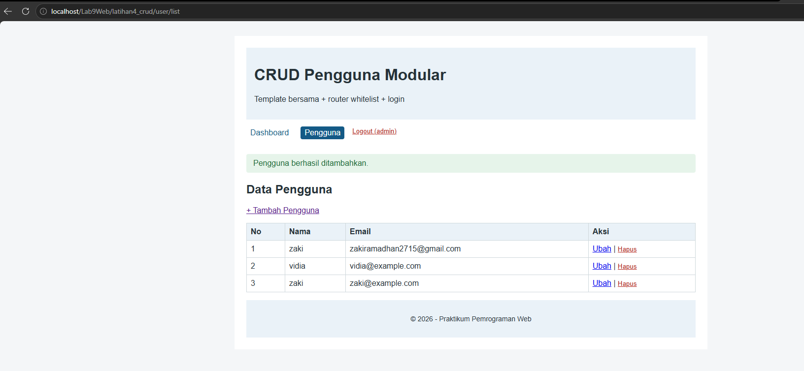

**e. Update**: ubah pengguna

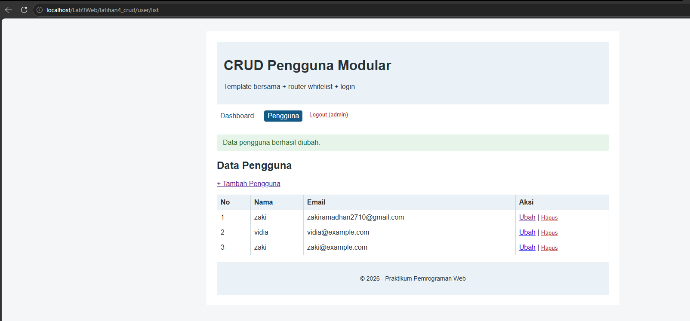

**f. Delete**: konfirmasi lalu hasil hapus (hapus memakai POST + token CSRF)

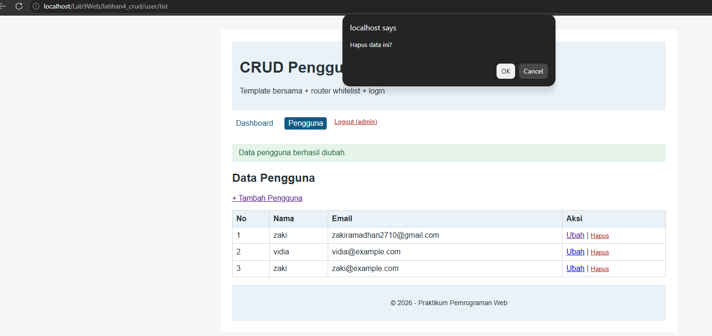

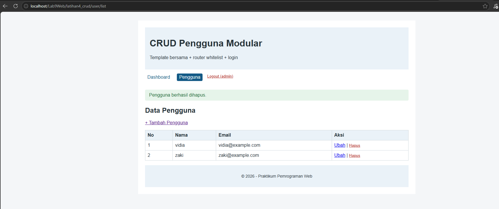

**g. Data di database** (phpMyAdmin, tabel `users`)

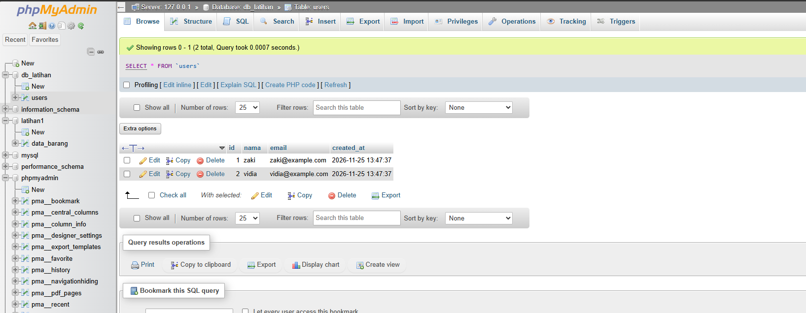

## Hasil Pengujian

| No | Pengujian | Hasil |
|---|---|---|
| 1 | `include` file hilang | Peringatan muncul, program lanjut |
| 2 | `require` file hilang | Error fatal, program berhenti |
| 3 | Tiga halaman memakai template yang sama | Berhasil |
| 4 | Pemanggilan function di dua halaman | Berhasil |
| 5 | Rute valid pada router | Halaman tampil sesuai rute |
| 6 | Rute tidak terdaftar | Halaman 404 |
| 7 | Daftar pengguna tanpa login | Tampil, tanpa tombol Ubah/Hapus |
| 8 | Buka `/user/add` tanpa login | Dialihkan ke Login |
| 9 | Login `admin` | Berhasil, kolom Aksi muncul |
| 10 | Tambah, ubah, hapus data | Berhasil, pesan sukses tampil |
| 11 | Data di phpMyAdmin | Sesuai dengan tampilan aplikasi |

## Kendala dan Solusi

**1. Halaman "Not Found" saat membuka aplikasi.** Alamat yang diketik tidak menyertakan nama folder proyek yang benar.

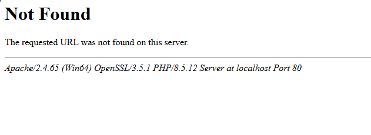

**2. Folder bertumpuk (`Lab9Web/Lab9Web`).** Hasil ekstrak zip membuat folder berlapis, sehingga alamat harus menyebut `Lab9Web` dua kali. Solusinya memindahkan isi folder dalam ke folder luar sehingga alamat menjadi `http://localhost/Lab9Web/latihan4_crud/index.php`.

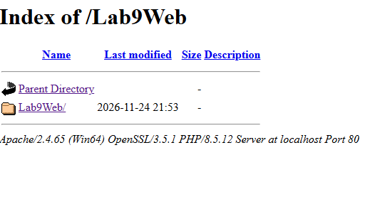

**3. Pesan "#1046 No database selected" saat import.** Hanya tampilan log phpMyAdmin; tabel dan data tetap terbentuk, dibuktikan pada tabel `users`.

## Jawaban Pertanyaan Pemahaman
1. **Modularisasi** adalah membagi aplikasi menjadi bagian kecil berdasarkan tanggung jawab. Manfaat: kode dapat dipakai ulang, mudah dipelihara, kerja tim lebih mudah dibagi.
2. `include` hanya memberi peringatan dan eksekusi lanjut; `require` menghasilkan error fatal dan eksekusi berhenti.
3. Konfigurasi database wajib ada dan tidak boleh dimuat dua kali, jadi `require_once` yang sesuai.
4. **Parameter** adalah variabel pada deklarasi function, **argumen** adalah nilai yang dikirim saat memanggil, **return** adalah nilai yang dikembalikan ke pemanggil.
5. Agar bagian yang sama tidak ditulis berulang dan perubahan cukup dilakukan di satu tempat.
6. `index.php` adalah titik masuk sekaligus router yang memilih file yang dimuat berdasarkan parameter `page`.
7. Whitelist memastikan hanya halaman yang memang disediakan aplikasi yang bisa dibuka.
8. Risiko path traversal atau pemanggilan file yang tidak dimaksudkan (misalnya file sensitif).
9. `RewriteCond` menentukan syarat (bukan file/direktori fisik), `RewriteRule` mengarahkan URL ke `index.php?page=...`.
10. `config`: koneksi DB; `views`: header, footer, tampilan bersama; `helpers`: fungsi umum (validasi, format); `modules`: halaman CRUD pengguna.
